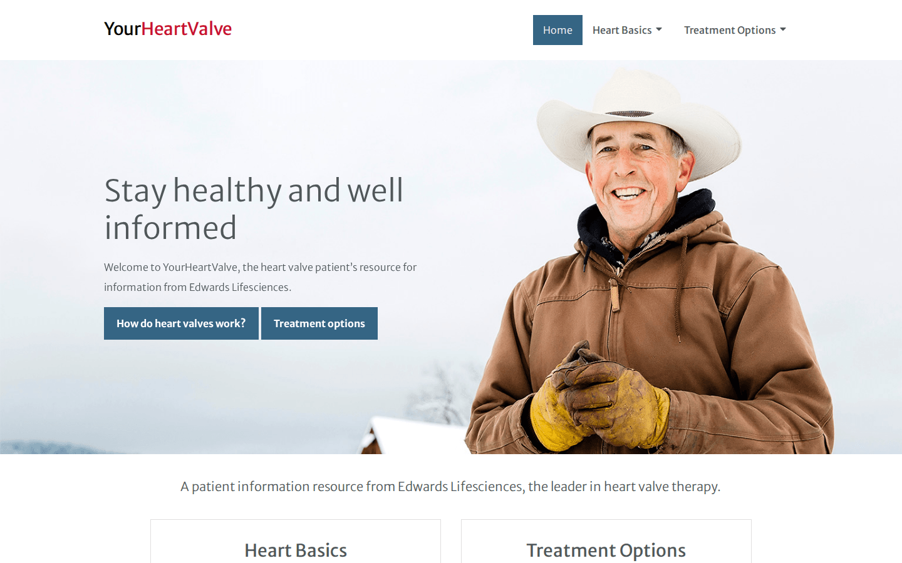
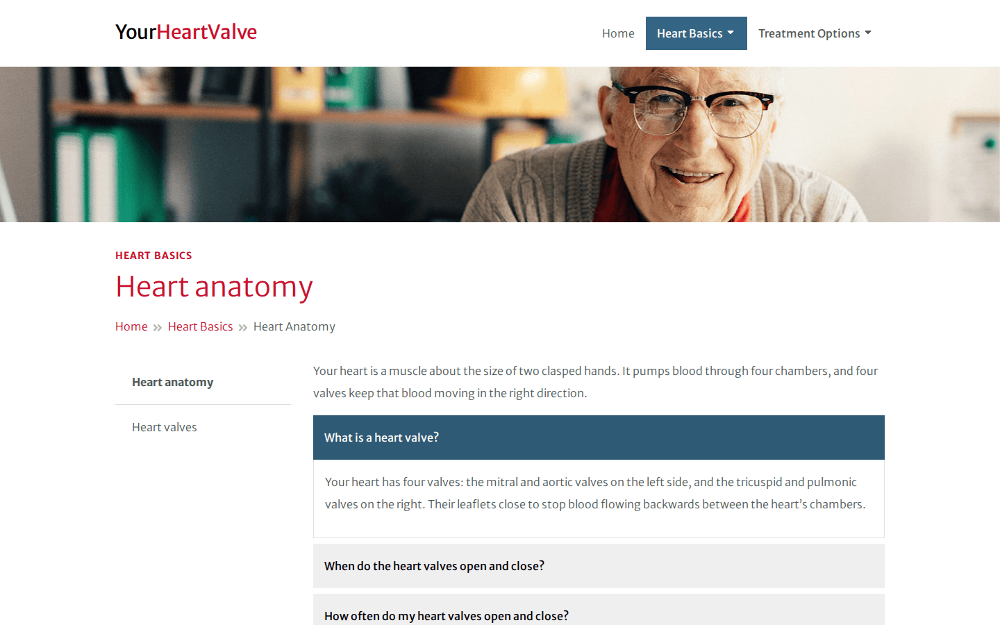
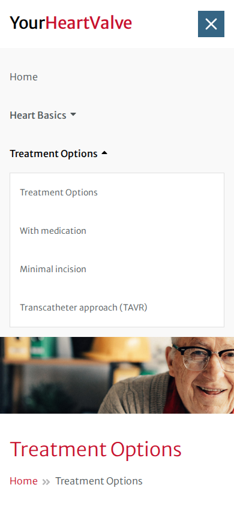
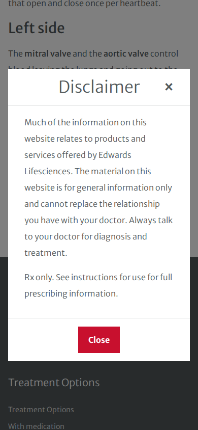
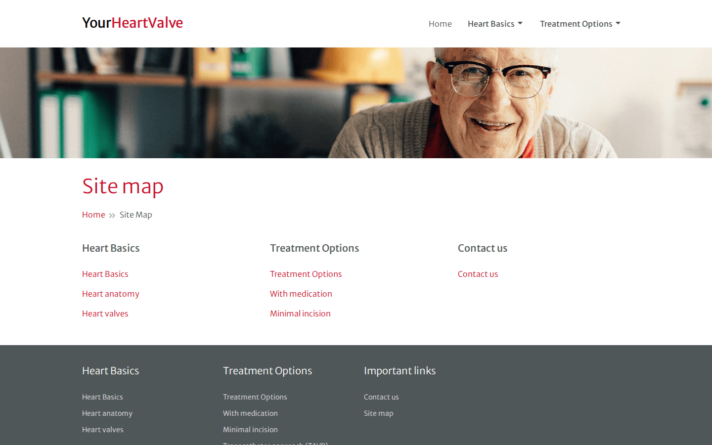
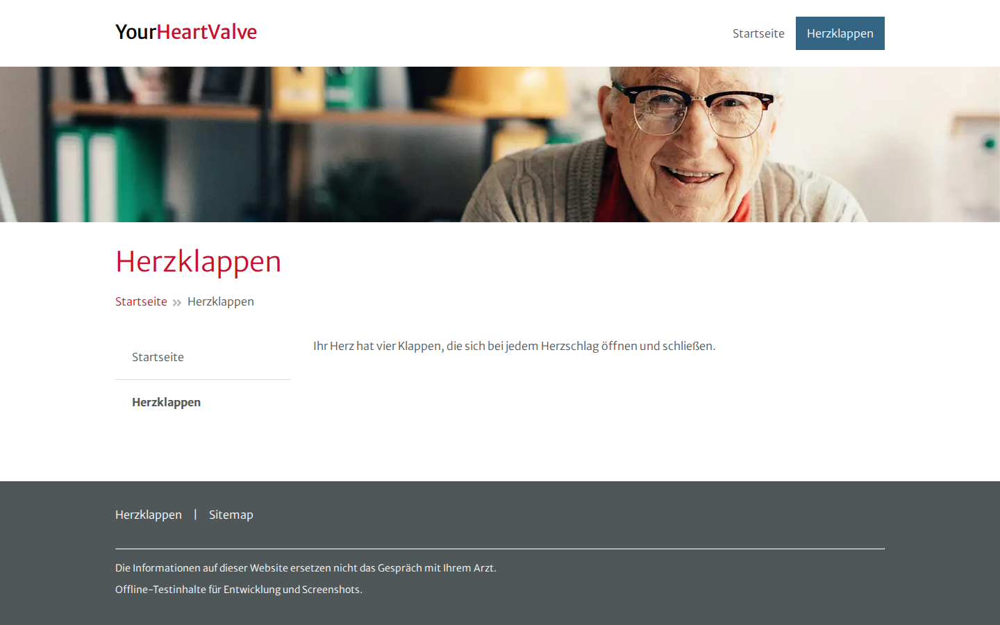
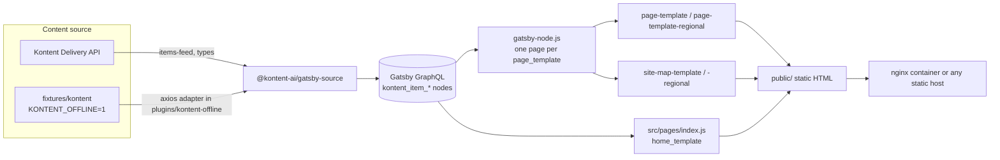

# YourHeartValve

The website for YourHeartValve, a patient information resource from Edwards Lifesciences about heart valve disease and its treatment. It is a static Gatsby 5 site whose pages, menus and copy are managed in [Kontent.ai](https://kontent.ai), a headless CMS. Editors add a page in Kontent and the next build turns it into plain HTML. There is an English default site and regional language sites under `/<language>/` (for example `/de/`).

The repository also contains a set of local fixtures. They let the site build, run and be tested without any access to the Kontent project, which is how the screenshots below were made.

| Home | Section page with an open FAQ |
| --- | --- |
|  |  |

| Mobile home | Mobile navigation | Disclaimer dialog |
| --- | --- | --- |
|  |  |  |

| Site map | German regional site |
| --- | --- |
|  |  |

All screenshots show fixture content, not production copy.

## How it works



- **Content model.** Pages are `page_template` items with a title, slug, a "topics" taxonomy, an aside menu, rich-text body, accordions, a disclaimer modal, an optional Marketo form and an optional "jump to" dropdown. The home page is a `home_template` built from `section` items, which hold cards, anchors and images. The header and footer are single items per language holding menus.
- **URLs.** A page lives at `/<topic>/<slug>`. It sits at `/<slug>` instead when it is the topic's landing page, has no topic, or is in the "Regional" topic. Regional sites prefix the language code, and a slug of `home` becomes the language root. Page creation and the site map share these rules in [`src/utils/pagePath.js`](src/utils/pagePath.js), so site-map links always match real pages.
- **Languages.** Every language in `GATSBY_KONTENT_LANGUAGE_CODENAMES` is sourced. Pages whose `system.language` is not `default` use the regional templates and layout. Kontent's language fallback returns untranslated items once per language; those resolve to existing paths and are skipped.
- **Preview.** The layouts carry Kontent Smart Link data attributes. Adding `?enable-ksl-sdk` to a URL turns on in-context editing links for editors.
- **Head tags.** Titles, meta tags and the CMS-managed `head_scripts` are rendered with the Gatsby Head API, so they are in the server HTML.

## Running it

The site needs Node 22 (pinned in `.nvmrc` and `engines`).

### Offline, from fixtures (no Kontent access needed)

With Docker, this builds the site and serves it on http://localhost:8080:

```sh
docker build -t yourheartvalve .
docker run --rm -p 8080:8080 yourheartvalve
```

With Node:

```sh
npm ci
npm run develop:offline   # dev server on http://localhost:8000
npm run build:offline     # static build in public/
npm run serve             # serves public/ on http://localhost:9000
```

`KONTENT_OFFLINE=1` makes three changes:

- It points the real source plugin at a reserved `kontent-fixtures.invalid` host.
- It installs an axios adapter that answers the plugin's `/types` and `/items-feed` requests from [`fixtures/kontent/content.js`](fixtures/kontent/content.js). The fixtures use Delivery API shapes and include language fallback.
- It leaves out the production consent-manager script.

Any other request fails, so an offline build cannot reach a real Kontent project. The fixtures cover the default site and a small German site, `de`.

### Against the real Kontent project

```sh
cp .env.example .env      # then fill in the project ID and languages
npm ci
npm run develop           # or: npm run build && npm run serve
```

| Variable | Purpose |
| --- | --- |
| `GATSBY_KONTENT_PROJECT_ID` | Kontent project (environment) ID. The build stops with a clear message if it is missing. |
| `GATSBY_KONTENT_LANGUAGE_CODENAMES` | Comma-separated language codenames; the first is the default. Falls back to `default`. |
| `GATSBY_DELIVERY_API_URL` | Base URL the browser uses to fetch the language list for the regional "Countries" menu. Without it the menu is hidden. |
| `KONTENT_OFFLINE` | `1` builds from fixtures and ignores the variables above. |

`GATSBY_*` values are inlined into the browser bundle, so never put an API key in a `GATSBY_` variable. The Docker image accepts the same values as build arguments:

```sh
docker build --build-arg KONTENT_OFFLINE= \
  --build-arg GATSBY_KONTENT_PROJECT_ID=... \
  --build-arg GATSBY_KONTENT_LANGUAGE_CODENAMES=default,de -t yourheartvalve .
```

## Scripts

| Command | What it does |
| --- | --- |
| `npm run develop` / `develop:offline` | Gatsby dev server, against Kontent or the fixtures |
| `npm run build` / `build:offline` | Static production build into `public/` |
| `npm test` | Jest unit and component tests (no network, no CMS) |
| `npm run lint` | ESLint (react, hooks, jsx-a11y; zero warnings) and Prettier check |
| `npm run format` | Apply Prettier |

## Tests

`npm test` runs 43 Jest tests with Testing Library and `babel-preset-gatsby`. They cover:

- **URL rules.** Path building, site-map grouping (including that it no longer mutates query data), menu and sidebar link preparation for default and regional sites, and external-link handling.
- **Configuration.** Environment parsing, including the unset language list that used to crash `gatsby-config`.
- **Offline adapter.** It refuses real hosts, applies language fallback, and every linked item in the fixtures resolves.
- **Accessible behaviour.** The navbar toggle and section menus (Escape, focus return, links not nested in buttons), accordion button and region wiring, dialog focus handling, breadcrumb `aria-current`, and the site map without a CMS page.

The offline production build is the integration check: it runs every page query against the fixtures through the real source plugin.

What is **not** verified here is the live Kontent path: the real content model, real rich text, the Marketo form and the CMS-managed head scripts. The fixtures were written to match the site's GraphQL queries, not exported from the production project.

## Project layout

```text
config/kontent.js            env -> source plugin options (offline mode, language parsing)
fixtures/kontent/            offline content: types, items, small SVG icons
plugins/kontent-offline/     local Gatsby plugin: fixture axios adapter + asset copy
gatsby-node.js               creates one page per page_template, plus site maps
src/pages/                   home (home_template) and 404
src/templates/               page and site-map templates, default and regional
src/components/              reusable pieces (Accordion, Modal, SiteLink, RichText, SEO, ...)
src/containers/              page sections (Navbar, Hero, Features, Contents, Footer)
src/utils/                   URL rules, menu preparation, script extraction
src/assets/scss/             7-1 Sass structure, BEM class names
test/, __mocks__/            Jest tests and Gatsby's documented module mock
docker/nginx.conf            non-root nginx config used by the Dockerfile
scripts/                     screenshot capture
```

## Design notes

- **Component variants.** Components and containers keep the original convention: each lives in `<Name>/variants/<Name><Variant>/`, named for example `HeroLarge` or `CardBasic`. Default and regional sites share a single navbar; regional sites pass their home path and language list.
- **Styles.** Styles follow the 7-1 Sass layout under `src/assets/scss` (abstracts, base, layouts, components) with BEM class names. Use the variables in `abstracts/_variables.scss` rather than hard-coded values. Breakpoints are min-width: `md` at 768px and `lg` at 1024px, used through `@include md { ... }`. Grid helpers (`grid-md-2`, `col-md-9`, `gap-2`, `order-md-1`) and spacing utilities (`mt-2`) are generated in `base/_utilities.scss`.
- **Brand palette.** The palette is crimson `#c8102e`, slate `#505759` and blue `#356584` on white and light greys, set in Merriweather Sans. Footer links use `#e0e2e2` on slate, about 5.7:1, for contrast.
- **Accessibility.** The site has a skip link, a `<main>` landmark and one `<h1>` per page. Breadcrumbs are a labelled `<nav>`. Menus, the sidebar, accordions and the dialog expose their state with `aria-expanded`, `aria-controls` and labelled regions, and the dialog manages focus. Animations follow the reduced-motion preference.
- **Links.** `SiteLink` sends internal routes through Gatsby's `Link` and opens absolute URLs in a new tab with `rel="noopener noreferrer"`.

## Dependencies and known limitations

- **Kontent's Gatsby packages are no longer maintained.** `@kontent-ai/gatsby-source` 10.0.1 and `@kontent-ai/gatsby-components` 10.0.0 are the renamed successors of `@kentico/gatsby-source-kontent` and `@kentico/gatsby-kontent-components`. They have the same publisher and repository, and the old names point to them. npm now marks both as "no longer supported", and these are their final releases. They work with Gatsby 5, but a long-term move would be to source content with `@kontent-ai/delivery-sdk` directly.
- **Patched axios.** The source plugin's own `axios` is overridden to the patched 0.34 line in `package.json`.
- **Undeclared Smart Link dependency.** `@kontent-ai/smart-link` 5 imports `@kontent-ai/delivery-sdk` at runtime without declaring it, so it is listed explicitly.
- **Remaining advisories.** `npm audit` reports 78 advisories (0 critical, 33 high). The highs come from Gatsby 5's own build toolchain (graphql-codegen, sharp/libvips, webpack-dev-middleware and similar) and have no fix within Gatsby 5. They affect the build machine, not the static output. The moderates are mostly Jest's dev tooling.
- **Sass deprecations are silenced.** The Sass partials still use `@import` and global colour functions, and `gatsby-plugin-sass` uses Sass's legacy JS API. Those deprecation warnings are silenced in `gatsby-config.js`; moving the partials to `@use` is the remaining step.
- **Language list.** The regional language list is fetched in the browser from the Delivery API, as before, rather than sourced at build time.
- **Head scripts on regional sites.** Head scripts come from the default-language header for every page, because Gatsby static queries cannot take a language. The old `body_scripts` no-JS fallback was never rendered correctly, and it is not rendered now.

## License

MIT. `LICENSE` is the original notice from the Kentico starter this site was built on ("Copyright (c) 2020 Kentico") and is kept as it is. YourHeartValve and Edwards Lifesciences names, copy and imagery belong to their owners.
